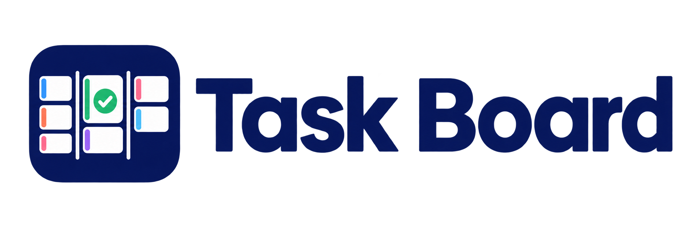

# Task Board



A native macOS kanban board for Apple Reminders. Your `ToDo`, `Doing`, and `Waiting` lists become three columns, and moving a card moves the reminder between lists.

There is no account, server, or separate database. Every card is a real reminder, so anything you change on the board also appears in Reminders on your other devices, and the other way round.

## Features

- Three-column board with drag and drop, plus a compact version in the menu bar
- Add a reminder by voice from any app with a global keyboard shortcut
- Add reminders hands-free with Siri on any of your Apple devices
- Colour-coded categories with multi-select filtering
- Priorities, due dates, and notes

## How it works


Task Board talks to the Reminders database on your Mac through Apple's EventKit framework.

| On the board | In Apple Reminders |
| --- | --- |
| Column | The list called `ToDo`, `Doing`, or `Waiting` |
| Card | An incomplete reminder in that list |
| Dragging a card to another column | Moving the reminder to that list |
| Clicking a card's circle | Marking the reminder complete |
| Category | A `#board-<name>` line in the reminder's Notes |

iCloud keeps those lists in sync across your devices, which is why a reminder created on your iPhone or with Siri shows up on the board.

## Apple Reminders stays fully usable

Task Board adds a view on top of Reminders. It doesn't replace the app or take your reminders over.

- **Nothing is imported or moved.** Your reminders stay in your Apple Account, in the same lists.
- **Keep using Reminders as usual** on your iPhone, iPad, Mac, or Apple Watch. Changes made in either place show up in the other.
- **All your other lists are left alone.** The board only shows `ToDo`, `Doing`, and `Waiting`. Shopping lists, shared lists, and anything else stay in Reminders and never appear on the board.
- **Removing Task Board loses nothing.** Delete the app and every reminder is still there. The only trace is any `#board-…` line in the Notes of categorised reminders.

macOS has no per-list permission, so Task Board has to ask for full access to Reminders even though it only loads those three lists.

## Requirements

- macOS 14 Sonoma or later
- Xcode or the Xcode Command Line Tools (Swift 5.9 or later)
- iCloud Reminders turned on, if you want sync and Siri

There are no third-party dependencies.

## Installation

Task Board is built from source.

```sh
git clone https://github.com/alexpcosta/reminders-kanban.git
cd reminders-kanban
sh build-app.sh
```

This creates `Task Board.app` in the project folder. Move it to `/Applications` and open it.

The build uses ad hoc signing by default, so you don't need an Apple Developer account. To sign with your own identity, run:

```sh
CODESIGN_IDENTITY='your signing identity' sh build-app.sh
```

macOS may ask for permissions again after you rebuild with a different signature.

## Setup

1. In Apple Reminders, create three lists named exactly `ToDo`, `Doing`, and `Waiting`. The names are case-sensitive. Create them under iCloud so they sync to your other devices.
2. Open Task Board and allow access to Reminders.
3. The first time you use voice capture, allow Microphone and Speech Recognition access.

If you denied a permission, turn it back on in **System Settings → Privacy & Security**.

## Using the board

- **Add a reminder:** click `+` at the top of a column.
- **Edit:** click a card.
- **Move:** drag a card by its three-line handle to another column.
- **Complete:** click the circle on a card.
- **Set category, priority, or due date:** right-click a card.
- **Filter:** click **Filter** and pick one or more categories. **Show all** clears the filter. Filtering only changes what you see.
- **Refresh:** the board reloads when the app becomes active, or when you click **Refresh**.

Within a column, cards are sorted by priority and then by title. Manual ordering isn't supported.

### Menu bar

Click the board icon in the menu bar for a compact version of the board. Option-click it to open the full window.

## Add a reminder with your voice

Press **Control–Option–Command–T** from any app while Task Board is running. You can also choose **File → Quick Capture**.

1. The Quick Capture window opens and starts listening straight away.
2. Say the reminder. The words appear as you speak.
3. Edit the text if you need to.
4. Press **Return** to save it to `ToDo`, or **Esc** to cancel.

You can also type instead of speaking. Dictation uses your Mac's system language.

## Add a reminder with Siri

Siri support comes from Apple Reminders, so it works on your iPhone, iPad, Mac, Apple Watch, and HomePod, and Task Board doesn't need to be running. The setup below makes Siri put new reminders in `ToDo`.

### Configure it

1. **Turn on iCloud Reminders** on each device, in your Apple Account's iCloud settings.
2. **Make `ToDo` your default list** on each device you use with Siri:
   - **iPhone or iPad:** open **Settings → Apps → Reminders → Default List** and choose `ToDo`.
   - **Mac:** open Reminders, choose **Reminders → Settings**, and set **Default List** to `ToDo`.
3. **Make sure Siri is turned on** in the device's Siri settings.
4. **For HomePod or HomePod mini, turn on Personal Requests** in the Home app. HomePod adds reminders through your iPhone or iPad, so that device needs to be on the same Wi-Fi network.

The default list applies to every reminder you create without naming a list, not only to the ones you intend for the board.

### Use it

With `ToDo` as the default list, you don't need to name a list:

> "Hey Siri, remind me to call the dentist."

You can also name the list, which works without changing the default:

> "Hey Siri, add call the dentist to my ToDo list."

The reminder appears on the board once iCloud has synced it and the board refreshes. If it doesn't show up, click **Refresh**.

## Categories

The app starts with Family, Work, and Personal. To add, rename, recolour, or remove categories, click **Categories** in the toolbar or open **Task Board → Settings**. Category definitions are stored on each Mac and don't sync.

A card's category is saved as a marker on its own line in the reminder's Notes, for example:

```text
Bring the signed form
#board-work
```

This means you can also set a category from Apple Reminders on any device by adding that line. Use the Notes field, because Apple doesn't give apps access to Reminders tags.

The marker comes from the name a category was created with and doesn't change if you rename it, so existing cards keep their category. If you remove a category, its markers stay in Reminders. Adding a category with the same original name brings those cards back.

## Optional: the Publish button

**Publish to display** runs a Shortcut on your Mac called `Publish Task Board`, which you create yourself in the Shortcuts app. Task Board doesn't care what it does, so you can use it to send your lists to a dashboard, a wall display, or anywhere else.

The button is hidden by default. To use it:

1. Create a Shortcut named exactly `Publish Task Board`.
2. Click **Categories** in the toolbar or open **Task Board → Settings**.
3. Turn on **Show Publish to display button**.

The button then appears in the board toolbar, and as **Publish** in the menu bar board. If the Shortcut doesn't exist, clicking the button only shows an error. Any URLs or tokens stay inside your Shortcut, not in this project.

## Privacy

Task Board has no analytics and makes no network connections of its own. Your reminders sync through your Apple Account as usual.

Dictation runs on your Mac when the language supports on-device recognition. Otherwise, macOS uses Apple's speech recognition service.

## Limitations

- The list names are fixed to `ToDo`, `Doing`, and `Waiting`.
- The board shows due dates without a time. Saving a reminder from the editor, or changing its due date on the board, removes any time set on it.
- The board doesn't update live. It refreshes when the app becomes active or when you click **Refresh**.

## Troubleshooting

| Problem | What to do |
| --- | --- |
| "Create a Reminders list named…" | Create the missing list in Reminders with that exact name, then refresh. |
| "There is more than one list named…" | Rename the extra list, then refresh. |
| The board is empty | Check that Task Board is allowed under **Privacy & Security → Reminders**, and that iCloud has finished syncing. |
| Dictation doesn't start | Check Microphone and Speech Recognition under **Privacy & Security**. |
| The keyboard shortcut does nothing | Make sure Task Board is running and that no other app uses the same shortcut. |
| Siri reminders go to the wrong list | Check the Default List on the device you spoke to. |

## Development

```sh
swift test
swift build -c release
```

The code is in `Sources/TaskBoard`, and `build-app.sh` packages the release build into an app bundle.

## License

Task Board is released under the [MIT License](LICENSE).
